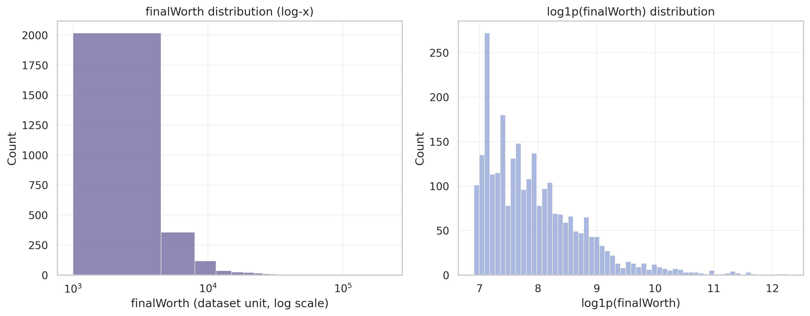
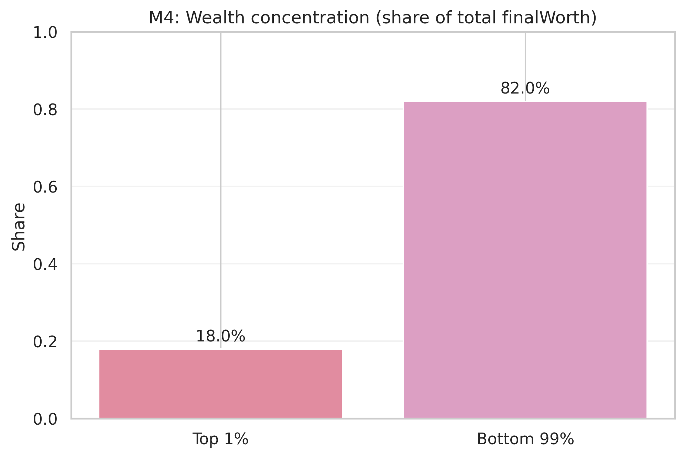
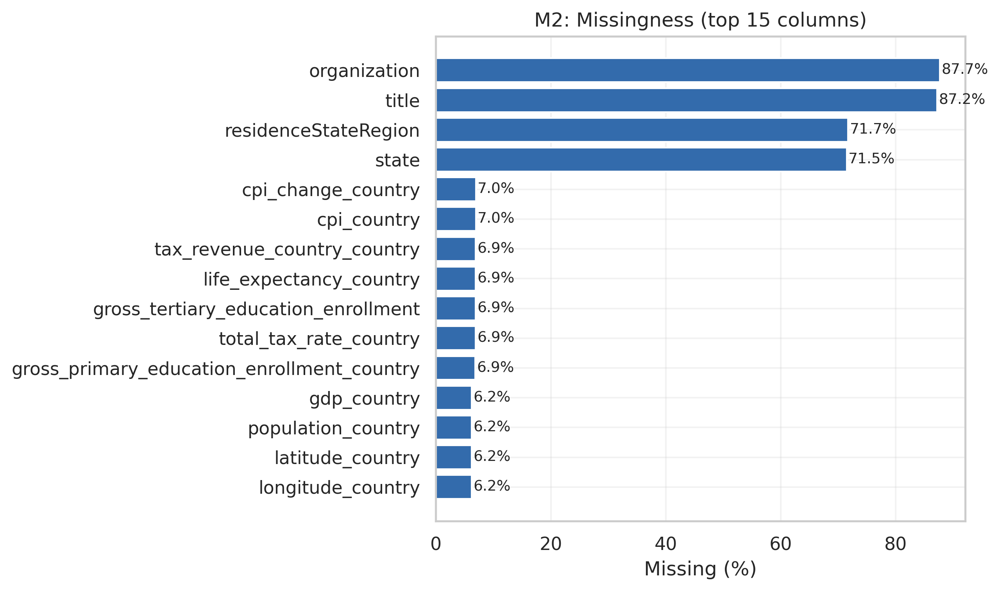

# Global Billionaire Wealth: An Applied Statistical Analysis

**UFUG 2104 — Applied Statistics | HKUST (Guangzhou)**  
**Dataset:** *Billionaires Statistics Dataset (2023)*  
**Project:** [GitHub repository](https://github.com/Jincan-LI-HUB/Applied-Statistics-Final-Project) · [Report](report.pdf) · [Executed notebook](code/formal/project_notebook.executed.html)

## Overview

This project investigates wealth concentration, demographic and industry differences, and the association between billionaire wealth and country-level economic indicators. Using a cross-sectional dataset of **2,640 billionaire records and 35 original variables**, it combines exploratory data analysis (EDA), statistical inference, regression, and robustness checks to distinguish **statistically detectable relationships from practically meaningful ones**.

The analysis is organized around a reproducible workflow: audit the raw data, justify variable selection, construct analysis-ready features, examine distributions and subgroups, test hypotheses, fit and diagnose regression models, and stress-test the findings.

> **Scope:** The dataset describes billionaires in a 2023 snapshot. Results about concentration and inequality refer **only to billionaires represented in this dataset**; they are not estimates of wealth inequality for the global population.

## Research questions

1. **Data quality:** How do missing data, duplicate labels, extreme observations, and record identity affect the analysis?
2. **Wealth concentration:** How skewed is billionaire net worth, and how much wealth is held by the upper tail?
3. **Group differences:** How do wealth distributions vary across industries, self-made status, and gender?
4. **Economic context:** Is individual billionaire wealth associated with a country's GDP and other macroeconomic indicators?
5. **Model reliability:** Do the associations persist after transformations, covariate adjustment, subgroup analysis, and sensitivity checks?

## Selected findings

| Finding | Evidence | Interpretation |
| --- | --- | --- |
| Wealth is heavily right-skewed | Median net worth ≈ **US$2.30B**; mean ≈ **US$4.62B** | Typical values are better described by medians and quantiles than the mean alone. |
| Wealth is concentrated within the billionaire sample | Top **1%** (27 records) account for **17.98%** of the sample's total net worth; sample Gini ≈ **0.549** | A small upper tail materially affects aggregate summaries. |
| GDP–wealth association is weak | Spearman's **ρ ≈ 0.097** on complete cases | Statistical significance should not be confused with a large effect. |
| Additional predictors improve fit only modestly | Multivariable OLS model **R² ≈ 0.048**; reported 10-fold out-of-sample **R² ≈ 0.024** | Country-level context and basic demographic controls explain little of individual wealth variation. |
| Inference depends on data structure | Missingness patterns differ by field; macroeconomic values repeat across individuals in the same country | Results require careful handling of missingness, grouping, and interpretation. |

Figures below are generated outputs included in the repository:

**Wealth distribution (raw and transformed scales)**



**Concentration in the wealthiest 1% of records**



**Missingness audit**



The complete discussion, uncertainty estimates, and interpretation boundaries appear in [the project report](report.pdf).

## Methods

| Stage | Techniques and checks |
| --- | --- |
| **Data audit** | Raw-file hashing and schema snapshot; candidate-key checks; missingness profiling; redundancy and duplicate-label checks |
| **Preparation** | Non-destructive cleaning; numeric parsing of GDP; log transformations; documented treatment of sparse or structurally missing fields |
| **Descriptive analysis** | Summary statistics, quantiles, histograms, complementary cumulative distribution functions (CCDFs), top-tail wealth shares, and Gini estimation |
| **Inferential statistics** | Pearson and Spearman correlation; subgroup comparisons; effect sizes; bootstrap confidence intervals; multiple-testing corrections |
| **Regression** | Raw- and log-scale ordinary least squares (OLS); multivariable specifications; robust standard errors; nested-model comparisons |
| **Diagnostics and robustness** | Residual and leverage diagnostics; variance inflation factors (VIF); top-1% exclusion; subgroup sensitivity checks; quantile regression; cross-validation |

The project also includes supplementary bootstrap and nonparametric diagnostics. These help examine the stability of conclusions rather than treating a single p-value or model fit as definitive.

## Repository structure

```text
Applied-Statistics-Final-Project/
├── README.md
├── report.pdf                         # Written project report
├── project_notebook.pdf               # Notebook exported to PDF
├── code/
│   ├── formal/
│   │   ├── project_notebook.ipynb          # Main analysis notebook (source)
│   │   ├── project_notebook.executed.ipynb # Saved executed notebook
│   │   └── project_notebook.executed.html  # Browser-readable outputs
│   ├── project_stastistic_analyse_and_visualization.ipynb
│   ├── remedy_run.py                      # Supplemental analyses; see note below
│   ├── remedy_run_part2.py                # Supplemental analyses; see note below
│   ├── remedy_supplementary_analysis.py
│   └── color_setting.json
├── data/
│   ├── raw/
│   │   └── Billionaires Statistics Dataset.csv
│   └── clean/
│       ├── billionaires_clean.csv
│       └── billionaires_clean.parquet
├── fig/                               # Exported figures (PNG and PDF)
└── delivery_requirments_and_standard/
    └── official_requirement.md        # Course project brief
```

## Getting started

### 1. Clone the repository

```bash
git clone https://github.com/Jincan-LI-HUB/Applied-Statistics-Final-Project.git
cd Applied-Statistics-Final-Project
```

### 2. Install the Python dependencies

A Python environment with Jupyter and the main analysis libraries is required:

```bash
python -m pip install jupyterlab numpy pandas scipy statsmodels matplotlib seaborn scikit-learn pyarrow
```

There is currently **no pinned `requirements.txt` or lockfile** in the repository, so exact environment reproduction is not guaranteed across library versions.

### 3. Explore the results

For a quick, no-execution review, open:

- [`report.pdf`](report.pdf) — narrative, statistical results, and conclusions;
- [`code/formal/project_notebook.executed.html`](code/formal/project_notebook.executed.html) — rendered notebook with saved outputs;
- [`fig/`](fig/) — exported plots.

To inspect or rerun the main analysis, open the source notebook:

```bash
jupyter lab code/formal/project_notebook.ipynb
```

The notebook locates the repository using its included raw CSV, writes derived tables and figures under `output/tab/` and `output/fig/`, and preserves the original data separately from cleaned features. These `output/` folders are generated during notebook execution and are distinct from the tracked `fig/` directory.

**Current reproducibility limitation:** `code/remedy_run.py` and `code/remedy_run_part2.py` contain unresolved Git merge-conflict markers. The notebook's final supplementary-analysis cell calls these scripts, so a complete **Run All** is not currently reliable without resolving those conflicts. The saved executed notebook and exported report are available for reviewing the results in the meantime. This README does not claim that a clean rerun has been verified.

## Interpretation and limitations

- **Cross-sectional observational data:** Associations do not identify causal effects of GDP, industry, gender, or self-made status on wealth.
- **Selection and coverage:** The sample consists only of listed billionaires, not a random sample of the world's population or wealth holders.
- **Clustered macroeconomic variables:** GDP and related national indicators repeat across records from the same country; naïvely treating all such values as independent can misstate precision.
- **Heavy tails and influential observations:** Extremely wealthy individuals can dominate untransformed averages and regression estimates. Log transforms, quantiles, and sensitivity tests help, but do not remove all modeling limitations.
- **Missingness and semantics:** Some geographic fields are structurally country-specific, while certain occupation/organization fields are sparsely populated. Variables require semantic review before use as predictors.
- **Prediction is not the principal claim:** The modest cross-validated fit supports a cautious explanatory and descriptive interpretation, not a strong individual-level wealth prediction claim.

## Project context

Developed for **UFUG 2104 Applied Statistics** at **The Hong Kong University of Science and Technology (Guangzhou)**. The assignment called for descriptive statistics, inferential analysis, regression, visualizations, and interpretation of the 2023 billionaire statistics dataset. The [official course brief](delivery_requirments_and_standard/official_requirement.md) is included for context.

Repository: [Jincan-LI-HUB/Applied-Statistics-Final-Project](https://github.com/Jincan-LI-HUB/Applied-Statistics-Final-Project)
